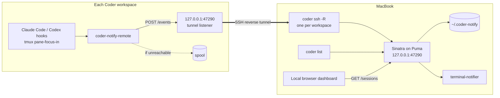
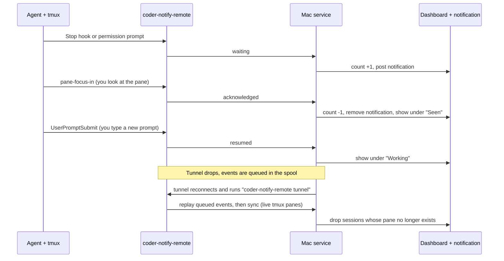

# coder-notify

A local browser dashboard for **Claude Code** and **Codex CLI** sessions running in **tmux** on your **Coder workspaces**.

The dashboard lists all your Coder machines with status circles: green for running and reachable, red for stopped, failed or deleting, yellow for starting or unreachable, and gray for unknown states. Notification connection status appears separately under each machine.

When an agent finishes responding, asks for permission or asks a question, the dashboard shows which workspace and tmux pane need attention. Optionally, a macOS notification appears too. Focusing the pane or clicking **Dismiss** marks the alert as seen; submitting a new prompt marks the agent as working.

The dashboard refreshes every five seconds. Workspace discovery runs every minute. Discovery never changes workspaces or starts stopped ones. Run `bin/coder-notify setup NAME` explicitly to install remote hooks on a running workspace.

The service uses Ruby with Sinatra + Puma, plain HTML and JavaScript for the browser, Minitest for tests, and one Bash script on each workspace. An optional native macOS menu bar app is in [macos/](macos/README.md).

To run the native menu bar app locally, open `macos/CoderNotify.xcodeproj` in Xcode, select **CoderNotify → My Mac**, and press **⌘R**. It starts the Ruby service if needed and shows all machines with colored status dots. Use its **Quit** button to stop the app and any service it started.

## Contents

- [How it works](#how-it-works)
- [What goes where](#what-goes-where)
- [MacBook setup](#macbook-setup)
- [Remote workspace setup (repeat per workspace)](#remote-workspace-setup-repeat-per-workspace)
- [When you create a new Coder workspace](#when-you-create-a-new-coder-workspace)
- [End-to-end smoke test](#end-to-end-smoke-test)
- [Uninstall](#uninstall)
- [Troubleshooting](#troubleshooting)
- [Design notes and limitations](#design-notes-and-limitations)
- [Development](#development)
- [Documentation consulted](#documentation-consulted)

---

## How it works

### Architecture



- **On each workspace**, Claude Code and Codex run hooks at key moments: a finished response, a permission request, a submitted prompt, session end. tmux runs a hook when you focus a pane. Each hook calls one script, `coder-notify-remote`, which:
  - works out which tmux pane it belongs to;
  - builds a tiny JSON event;
  - POSTs it in the background to `127.0.0.1:47290` on the workspace.
  
  That address is the workspace end of an SSH reverse tunnel. If the Mac can't be reached, the event goes into a small on-disk queue (the *spool*) and is replayed later.
- **On the Mac**, a Sinatra app runs under Puma, bound to `127.0.0.1` only. It has three jobs:
  - **Discovery:** it runs `coder list --output json` at startup and every minute to find your workspaces.
  - **Tunnels:** for each workspace you have *enabled*, and only while it is running with a connected agent, it keeps one `coder ssh -R 47290:127.0.0.1:47290 <workspace>.<agent>` process alive. It restarts that process if it breaks.
  - **Events:** it checks each event's token, updates its state (saved to `~/.coder-notify/state.json`), posts or removes macOS notifications.
- **The browser dashboard** reads `GET /sessions` every five seconds. Run `bin/coder-notify browser` to open it with an authenticated browser session.

### Event and state workflow



Each agent session is in one of three states:

| State | Counted? | Notification? | Enters on | Leaves on |
| --- | --- | --- | --- | --- |
| **Needs attention** | yes | posted | `waiting` | `acknowledged`, Dismiss, `resumed`, `ended`, sync (pane gone) |
| **Seen** (still waiting) | no | removed | `acknowledged` or Dismiss; or `waiting` while the pane is already in front of you | a new `waiting`, `resumed`, `ended`, sync |
| **Working** | no | none | `resumed` | `waiting`, `ended`, sync |

**"I focused this pane" is kept separate from "the agent resumed."** Focusing a pane sends `acknowledged`: the alert clears, but the entry stays under *Seen* with its reason ("Needs permission"). The service never claims the approval was resolved. Only a real prompt submission (`resumed`) marks the agent as working. Neither Claude Code nor Codex has a hook that fires when you answer a permission prompt, so this is deliberate.

**Reconnect and reconciliation.**
1. When a tunnel (re)connects, `coder-notify-remote tunnel` first checks that it reaches *this* service with a token it accepts.
2. It then prints `READY`.
3. It replays queued events, oldest first.
4. Finally it sends a `sync` event listing the tmux panes that still exist, and the service forgets sessions in panes that are gone. You can also run `coder-notify-remote sync` by hand on a workspace.

**Duplicates and ordering are safe:**
- Every event has a unique `event_id`. The service remembers the last 2000, even across restarts, and ignores repeats. So replaying the spool twice is harmless.
- Events carry the workspace's send time in milliseconds. An older event never overrides a newer one, even if it arrives later.

### Events

| Event | Sent when | Claude Code hook | Codex hook |
| --- | --- | --- | --- |
| `waiting` (reason `done`) | the agent finished its turn | `Stop` | `Stop` (or legacy `notify`) |
| `waiting` (reason `permission`) | the agent asks for approval | `Notification` with `notification_type: permission_prompt` | `PermissionRequest` |
| `waiting` (reason `question`) | the agent asks you something | `Notification` with `notification_type: elicitation_dialog` | – |
| `resumed` | you submitted a prompt | `UserPromptSubmit` | `UserPromptSubmit` |
| `ended` | the session exited | `SessionEnd` | `SessionEnd` |
| `acknowledged` | you focused the pane | tmux `pane-focus-in` | tmux `pane-focus-in` |
| `sync` | a tunnel (re)connected | – | – |

An agent instance is identified by **Coder workspace id + tmux pane id + agent type + agent session id**:
- **Workspace id:** comes from the token, not from the payload.
- **Pane id:** `$TMUX_PANE`, for example `%12`.
- **Agent type:** `claude` or `codex`.
- **Session id:** from the hook.

The label shown in the dashboard (for example `main:1.0`) comes from `tmux display-message -p -t "$TMUX_PANE" '#{session_name}:#{window_index}.#{pane_index}'`.

A tmux pane runs one agent at a time. When a new session appears in a pane, older sessions recorded for that pane are dropped.

### Privacy and security

- **Loopback only.**
  - The service binds to `127.0.0.1` (see `config/puma.rb`).
  - Coder's `-R` always binds the workspace side to `127.0.0.1`, so nothing else on either network can reach it.
  - The service also rejects any request whose `Host` header isn't loopback, which protects against DNS rebinding.
- **Tokens, one per workspace.**
  - `bin/coder-notify enable` creates a random 256-bit token for each workspace. It's stored in `~/.coder-notify/tokens.json` with mode 600.
  - The token authenticates `POST /events` and **identifies the workspace**, so one workspace can't post events as another.
  - A token copied to the wrong workspace is caught, because the event's `CODER_WORKSPACE_NAME` must match.
  - On the workspace, `curl` reads the token from a pipe (`-K`), so it never appears in `ps`.
- **The dashboard has its own token** (`~/.coder-notify/menu-token`). Only that token (or its authenticated browser cookie) can read `GET /sessions` or dismiss entries, so a workspace can't see your other workspaces through its tunnel. The browser launcher passes this token in a URL fragment (never sent in the HTTP request); the page immediately clears it and exchanges it for an HttpOnly, SameSite=Strict session cookie. The public dashboard HTML contains no tokens or workspace data.
- **Validated, tiny payloads.**
  - JSON only, 64 KB maximum.
  - Fixed allowed values for `type`, `agent` and `reason`.
  - Strict formats for ids and labels; unknown fields are dropped.
- **No prompts or transcripts.**
  - The remote script reads a few fields from the hook JSON: event name, session id, notification type and subagent id.
  - It never forwards `prompt`, `message`, `transcript_path`, tool input, or Codex's `input-messages` / `last-assistant-message`.
  - Tests check this.
- **Hooks never stall or change an agent.**
  - The hook prints nothing. Claude Code and Codex would add stdout from `UserPromptSubmit` to the model's context.
  - It always exits 0 and returns in well under a second.
  - It sends the HTTP request in a detached background process with a 1 s connect timeout and a 3 s total timeout.

---

## What goes where

| In this repository | Installed at | Where | By |
| --- | --- | --- | --- |
| `bin/coder-notify`, `lib/`, `config.ru`, `config/puma.rb` | run from the repository | Mac | – |
| `launchd/dev.coder-notify.plist.example` | `~/Library/LaunchAgents/dev.coder-notify.plist` (optional) | Mac | you |
| (created by the service) | `~/.coder-notify/` (`tokens.json`, `menu-token`, `state.json`, `workspaces.json`, `logs/`) | Mac | service |
| `remote/bin/coder-notify-remote` | `~/.local/bin/coder-notify-remote` | workspace | you |
| (printed by `bin/coder-notify enable`) | `~/.config/coder-notify/env` | workspace | you |
| `remote/tmux/coder-notify.tmux.conf` | `~/.config/coder-notify/coder-notify.tmux.conf`, plus one line in `~/.tmux.conf` | workspace | you |
| `remote/claude/settings.hooks.json` | copied to `~/.config/coder-notify/claude-hooks.json`, then merged into `~/.claude/settings.json` | workspace | you |
| `remote/codex/hooks.json` | copied to `~/.config/coder-notify/codex-hooks.json`, then merged into `~/.codex/hooks.json` | workspace | you |
| `remote/merge-hooks.jq`, `remote/remove-hooks.jq` | `~/.config/coder-notify/` | workspace | you |
| `remote/codex/notify.toml.example` | only for Codex without hooks; see below | workspace | you |
| (created by the script) | `~/.cache/coder-notify/spool/`, `~/.cache/coder-notify/remote.log` | workspace | script |

---

## MacBook setup

### 1. Dependencies

| Need | Check | Install |
| --- | --- | --- |
| Ruby 3.4.7 (pinned in `.ruby-version`) | `ruby -v` in the repository | `rbenv install 3.4.7` |
| Bundler | `bundle -v` | ships with Ruby 3.4 |
| Coder CLI, logged in | `coder version && coder list` | https://coder.com/docs/install, then `coder login <your deployment URL>` |
| jq (for the tests and the remote merge steps) | `jq --version` | `brew install jq` |

The `terminal-notifier` gem (3.1) bundles an ad-hoc-signed, universal (Apple silicon and Intel) `terminal-notifier.app`, so you don't need Homebrew's `terminal-notifier`.

### 2. Install and test

```sh
cd ~/work/coder-notify
bundle install
bundle exec rake test        # everything runs locally; no Coder workspace needed
```

### 3. Start the service (foreground, for a first try)

```sh
bin/coder-notify server
```

In another terminal:

```sh
curl -s http://127.0.0.1:47290/health          # {"ok":true,"service":"coder-notify"}
lsof -nP -iTCP:47290 -sTCP:LISTEN              # must show 127.0.0.1:47290, nothing else
bin/coder-notify status                        # workspaces from `coder list`, all "not enabled"
```

The first start creates `~/.coder-notify/` (mode 700) and the dashboard token.

### 4. Open the browser dashboard

With the service running, open another terminal in the repository:

```sh
bin/coder-notify browser
```

This opens `http://127.0.0.1:47290` in your default browser and authenticates it automatically. Keep the tab pinned if you want it handy. No additional app or browser extension is needed. All discovered machines appear even before remote hooks are installed.

If you open the URL directly before authenticating, the page tells you to run the browser command. Run it again if the browser session is cleared.

### 5. Notifications (optional)

The first notification makes macOS ask whether **terminal-notifier** may send notifications; allow it. To check or change this later, go to **System Settings › Notifications › terminal-notifier**. Choose *Alerts* if you want them to stay on screen until dismissed.

Test it by hand:

```sh
bundle exec ruby -e 'require "terminal-notifier"; p TerminalNotifier.notify("Hello", title: "coder-notify", group: "coder-notify-test")'
bundle exec ruby -e 'require "terminal-notifier"; p TerminalNotifier.remove("coder-notify-test")'
```

If nothing appears:
- Run the bundled binary's self-check:

  ```sh
  "$(bundle exec ruby -e 'require "terminal-notifier"; print TerminalNotifier::BIN_PATH')" -diagnose
  ```

- Check that a Focus mode isn't hiding notifications.

Clicking a notification brings Ghostty (`com.mitchellh.ghostty`) to the front. Set `CODER_NOTIFY_ACTIVATE` to another bundle id to change that, for example `com.cmuxterm.app`.

**To run without notifications,** start the service with `CODER_NOTIFY_NOTIFICATIONS=0`. The dashboard works the same either way.

### 6. Run it at login (optional)

```sh
mkdir -p ~/.coder-notify/logs
cp launchd/dev.coder-notify.plist.example ~/Library/LaunchAgents/dev.coder-notify.plist
sed -i '' "s#/Users/YOU#$HOME#g" ~/Library/LaunchAgents/dev.coder-notify.plist
# Check the ruby path, the repository path and CODER_BIN (`which coder`) in the file, then:
plutil -lint ~/Library/LaunchAgents/dev.coder-notify.plist
launchctl bootstrap gui/$(id -u) ~/Library/LaunchAgents/dev.coder-notify.plist
launchctl print gui/$(id -u)/dev.coder-notify | grep -E '^\s*(state|pid)'
tail -f ~/.coder-notify/logs/service.log
```

- **Restart** (after editing code): `launchctl kickstart -k gui/$(id -u)/dev.coder-notify`
- **Stop and unload:** `launchctl bootout gui/$(id -u)/dev.coder-notify`

Stop any foreground `bin/coder-notify server` first, because both use port 47290.

### Configuration

All settings are environment variables; defaults are in `lib/coder_notify/config.rb`.

| Variable | Default | Meaning |
| --- | --- | --- |
| `CODER_NOTIFY_HOME` | `~/.coder-notify` | tokens, state, logs |
| `CODER_NOTIFY_PORT` | `47290` | Mac service port (on 127.0.0.1) |
| `CODER_NOTIFY_REMOTE_PORT` | `47290` | port opened on each workspace's 127.0.0.1 |
| `CODER_BIN` | `coder` | path to the Coder CLI (use an absolute path under launchd) |
| `CODER_NOTIFY_DISCOVERY_INTERVAL` | `60` | seconds between `coder list` runs |
| `CODER_NOTIFY_NOTIFICATIONS` | `1` | `0` turns macOS notifications off |
| `CODER_NOTIFY_ACTIVATE` | `com.mitchellh.ghostty` | app brought forward when you click a notification |

---

## Remote workspace setup (repeat per workspace)

The recommended setup is one command from this repository on your Mac:

```sh
bin/coder-notify setup product-trials --install-deps
```

Replace `product-trials` with the name shown by `coder list`. The workspace must already be running with a connected main agent. The setup command passes `--disable-autostart` on every SSH connection, so it will not start a stopped workspace, including if its state changes during setup. No SSH alias configuration or `scp` is needed.

This command checks remote dependencies and existing configuration, securely uploads the reporter and workspace token, merges Claude/Codex hooks without replacing other settings, installs the tmux focus hook, applies it to a running tmux server, and enables monitoring on the Mac. Rerunning it updates the installation without duplicating hooks. Original files are backed up under `~/.config/coder-notify/backups/` on the workspace, and existing dotfile symlinks are preserved. Credentials travel over SSH stdin and are not printed or put in process arguments.

By default it configures both Claude and Codex. To configure just one:

```sh
bin/coder-notify setup product-trials --agent codex --install-deps
bin/coder-notify setup product-trials --agent claude --install-deps
```

`--install-deps` installs missing `bash`, `curl`, `jq`, `tmux` and `tar` using apt-get, if root or passwordless sudo is available. Omit the flag to check dependencies without installing packages. Unsupported package managers, missing sudo access, invalid existing JSON, disabled Claude hooks, or unsupported Codex hooks produce an actionable error before the Mac enables a new workspace.

For Codex versions with `--no-daemon`, setup adds `~/.local/bin/coder-notify-codex` and a managed alias to `.bashrc` and `.zshrc`. Existing custom Codex aliases/functions are preserved; if one exists, the command tells you to use that wrapper instead. Open a new shell to pick up the alias, restart existing agent sessions, and reattach tmux once for focus reporting.

**Codex requires one trust review:** run `/hooks` inside Codex and review/trust the coder-notify commands. The installer does not rewrite trust records or bypass this check. See the [official hook trust documentation](https://learn.chatgpt.com/docs/hooks). After that, the same hook definitions do not need a new review on each installer run.

Keep the menu bar app or Ruby service running while using alerts. Setup also works while the Mac service is stopped; its tunnel starts the next time the service runs. A new workspace created later can be set up with the same command and its new name. A recreated workspace gets a new token automatically.

### Manual setup alternative

The following steps are an alternative if you prefer to inspect and install each piece yourself.

The commands use the host names written by `coder config-ssh` (`Host coder.*`).

> **About `coder.<workspace>.workspace`:** your workspaces have two agents: `workspace` (the main VM, where tmux runs) and a `devcontainer` sub-agent. With two agents, plain `coder.<workspace>` fails with "multiple agents found", so we name the agent: `coder.<workspace>.workspace`.

> **SSH through Coder starts stopped workspaces:** that's the Coder CLI's default. Only run these steps while the workspace is running.

### 1. Check prerequisites on the workspace

On the Mac, in the repository:

```sh
cd ~/work/coder-notify
WS=api-work                     # your workspace name, as shown by `coder list`
ssh coder.$WS.workspace 'for t in bash curl jq tmux; do printf "%-5s " $t; command -v $t || echo MISSING; done; tmux -V; echo "CODER_WORKSPACE_NAME=$CODER_WORKSPACE_NAME"'
```

- **Tools:** you need bash, curl, jq and tmux (3.2 or newer recommended). If jq is missing, install it on the workspace, for example `sudo apt-get install -y jq`.
- **`CODER_WORKSPACE_NAME`:** the Coder agent sets this. It should print your workspace name.

### 2. Enable the workspace on the Mac

```sh
bin/coder-notify enable $WS
```

This looks up the workspace's Coder id and creates its token. It prints a small block of shell commands that create `~/.config/coder-notify/env` on the workspace; you'll paste it in step 4.

`bin/coder-notify token $WS` prints it again. Within a few seconds the Mac starts trying to tunnel to the workspace. Until you finish the steps below, the dashboard shows "remote not installed" (or "not configured"), and it retries every 5 minutes.

### 3. Copy the files from the Mac

```sh
ssh coder.$WS.workspace 'mkdir -p ~/.local/bin ~/.config/coder-notify && chmod 700 ~/.config/coder-notify'
scp remote/bin/coder-notify-remote coder.$WS.workspace:.local/bin/
scp remote/tmux/coder-notify.tmux.conf remote/merge-hooks.jq remote/remove-hooks.jq coder.$WS.workspace:.config/coder-notify/
scp remote/claude/settings.hooks.json coder.$WS.workspace:.config/coder-notify/claude-hooks.json
scp remote/codex/hooks.json coder.$WS.workspace:.config/coder-notify/codex-hooks.json
```

### 4. Install the script and its settings (on the workspace)

```sh
ssh coder.$WS.workspace
chmod +x ~/.local/bin/coder-notify-remote
# Paste the block printed by `bin/coder-notify enable` here. It creates ~/.config/coder-notify/env (mode 600).
~/.local/bin/coder-notify-remote check
```

`check` prints the config file, tools, workspace name, tmux pane and `focus-events` setting. Once the tunnel is up (step 8) it also shows the service's health.

### 5. Claude Code hooks (merge, don't overwrite)

The merge keeps every existing setting and hook. It only adds four hook groups that run `coder-notify-remote hook claude`, and running it again replaces them rather than duplicating them.

```sh
mkdir -p ~/.claude
[ -f ~/.claude/settings.json ] || echo '{}' > ~/.claude/settings.json
cp ~/.claude/settings.json ~/.claude/settings.json.before-coder-notify
jq -s -f ~/.config/coder-notify/merge-hooks.jq ~/.claude/settings.json ~/.config/coder-notify/claude-hooks.json \
  > ~/.claude/settings.json.new && mv ~/.claude/settings.json.new ~/.claude/settings.json
diff <(jq -S . ~/.claude/settings.json.before-coder-notify) <(jq -S . ~/.claude/settings.json)   # review what changed
```

- **Which events:** `Notification`, `Stop`, `UserPromptSubmit` and `SessionEnd`.
  - `Notification` has no matcher, so the script sees every notification type. It reports only `permission_prompt` and `elicitation_dialog` and ignores the rest, for example `idle_prompt`, which would duplicate `Stop`.
- **Scope:** hooks from user, project and local settings files add up. Your project `.claude/settings.json` hooks keep working alongside these, unless a settings file sets `disableAllHooks`.
- **Reload:** Claude Code picks up edits to settings files in running sessions. In each session, type `/hooks` to confirm the coder-notify hooks are listed. If a session doesn't show them, restart it: `/exit`, then `claude --continue`.

### 6. Codex CLI hooks (merge, trust, and `--no-daemon`)

First check that your Codex version has hooks. They are stable since 0.124:

```sh
codex --version
codex features list | grep -w hooks          # "hooks  stable  true"
```

Merge the hooks into `~/.codex/hooks.json`. This uses the same jq program; the file format is the same as Claude Code's:

```sh
mkdir -p ~/.codex
[ -f ~/.codex/hooks.json ] || echo '{}' > ~/.codex/hooks.json
cp ~/.codex/hooks.json ~/.codex/hooks.json.before-coder-notify
jq -s -f ~/.config/coder-notify/merge-hooks.jq ~/.codex/hooks.json ~/.config/coder-notify/codex-hooks.json \
  > ~/.codex/hooks.json.new && mv ~/.codex/hooks.json.new ~/.codex/hooks.json
```

This adds `Stop`, `PermissionRequest`, `UserPromptSubmit` and `SessionEnd`.

If you already define hooks inline under `[hooks]` in `~/.codex/config.toml`, Codex loads both and prints a warning at startup. To avoid the warning, move one set into the other.

**Trust the hooks.** Codex skips new user hooks until you review them.
1. Start `codex`.
2. Type `/hooks`.
3. Trust the four `coder-notify-remote hook codex` entries.

Trust is stored in `~/.codex/config.toml` and covers the command string, not the script's contents.

**Run Codex with `--no-daemon`.** Recent Codex versions (0.156 and later) run sessions inside a shared background server by default. That server's hooks inherit `$TMUX_PANE` from whichever pane first started it, which may be the wrong pane.
- To be safe, the script reports nothing when a hook isn't running inside the pane named by `$TMUX_PANE`, and logs a hint to `~/.cache/coder-notify/remote.log`.
- To get correct Codex events, start Codex in-process in its pane:

  ```sh
  codex --help | grep -q -- --no-daemon && echo "alias codex='codex --no-daemon'" >> ~/.bashrc   # or ~/.zshrc
  ```

Then restart your running Codex sessions (quit and start `codex` again) so they load the hooks.

*Fallback for Codex without hooks (older than 0.124):* follow `remote/codex/notify.toml.example`. It adds a top-level `notify = ["/home/<you>/.local/bin/coder-notify-remote", "codex-notify"]`. It only reports "finished responding". Don't use it together with the hooks.

### 7. tmux focus hook

```sh
grep -qF 'coder-notify.tmux.conf' ~/.tmux.conf 2>/dev/null \
  || echo 'source-file -q ~/.config/coder-notify/coder-notify.tmux.conf' >> ~/.tmux.conf
tmux source-file ~/.tmux.conf                  # if tmux is already running
tmux show-options -gv focus-events             # on
tmux show-hooks -gw | grep pane-focus-in       # pane-focus-in[42] run-shell -b ".../coder-notify-remote focus #{pane_id} ..."
```

- **Detach and re-attach once** (`Ctrl-b d`, then `tmux attach`). That makes tmux ask Ghostty to report focus changes (`focus-events`).
- **When the hook fires:** Ghostty reports focus in and out, even through SSH. `pane-focus-in` then fires when you switch panes, windows or sessions, and when the Ghostty window gains focus.
- **Your other hooks are safe:** our hook uses its own slot, `pane-focus-in[42]`, so it never replaces your hooks, and reloading your config doesn't duplicate it.
- **Side effect:** `focus-events on` also passes focus reports to programs in your panes (Vim and others). That's usually harmless or useful.
- **Without focus events:** alerts still clear when you submit a prompt, or when you click **Dismiss**.

### 8. Check the reverse tunnel

On the Mac:

```sh
bin/coder-notify status              # the workspace should show: running  connected  tunnel verified
pgrep -fl 'coder ssh --disable-autostart'
```

On the workspace:

```sh
ss -ltn | grep 47290                 # LISTEN ... 127.0.0.1:47290 (loopback only)
curl -s http://127.0.0.1:47290/health                                   # {"ok":true,"service":"coder-notify"}
~/.local/bin/coder-notify-remote check                                  # health includes "workspace":"<name>"
```

If the dashboard shows a problem instead, see [Troubleshooting](#troubleshooting).

---

## When you create a new Coder workspace

The Mac finds new workspaces automatically, within a minute, through `coder list`. They appear in the dashboard as **not enabled**. **Nothing is installed or changed by discovery.** To monitor one, run `bin/coder-notify setup <new name> --install-deps` and complete the one-time Codex `/hooks` trust review if using Codex.

When a workspace is deleted, it disappears from the dashboard at the next discovery, along with its sessions and its tunnel.

If you delete a workspace and create a new one with the same name, it gets a new Coder id. Run `bin/coder-notify setup <name> --install-deps` again: this replaces the old token and installs the new workspace's files.

---

## End-to-end smoke test

This shows an entry appearing, its notification being posted, and both clearing when you return to the pane.

1. **Setup.** The Mac service is running (`bin/coder-notify status`) and the browser dashboard is open. The workspace shows **Notifications: connected**.
2. **Two panes.** In Ghostty, `ssh coder.$WS.workspace`, then `tmux new -s demo`, then split the window with `Ctrl-b %`. You now have panes `demo:0.0` and `demo:0.1`.
3. **Simulate an agent in pane 0.** This needs no agent. The `sleep` gives you time to look away, because a wait that starts while you are looking at the pane counts as already seen:

   ```sh
   sleep 3; echo '{"hook_event_name":"Notification","notification_type":"permission_prompt","session_id":"smoke-1"}' \
     | ~/.local/bin/coder-notify-remote hook claude
   ```

   Press Enter, then immediately press `Ctrl-b o` to move to pane 1.
4. **An entry appears.** Within about five seconds:
   - the dashboard attention count shows **1**;
   - the agent activity list shows **Claude · $WS · demo:0.0 — Needs permission**;
   - a macOS notification **"Claude on $WS"** appears.
5. **Return to pane 0** (`Ctrl-b o`). Both clear: the count becomes zero, the entry becomes **Seen**, and the notification is removed from Notification Center.
6. **Resume.** In pane 0, run:

   ```sh
   echo '{"hook_event_name":"UserPromptSubmit","session_id":"smoke-1"}' | ~/.local/bin/coder-notify-remote hook claude
   ```

   The entry moves to **Working**.
7. **End.** Run the same command with `"SessionEnd"` in place of `"UserPromptSubmit"`. The entry disappears.
8. **With a real agent.**
   - In pane 0, run `claude` and ask it to run a shell command. Switch to pane 1 while it works.
   - The permission prompt produces an alert. Switching back clears it.
   - After you approve, a **Finished responding** alert follows when it's done (if you're in pane 1 by then).
   - Repeat with `codex` (started with `--no-daemon`).
9. **Reconnect.**
   - Stop the Mac service; its tunnels close with it. Run step 3 again, switching to pane 1 as before.
   - The event can't be delivered, so it is queued in `~/.cache/coder-notify/spool/`.
   - Start the service. Within seconds the tunnel reconnects, the queued event is replayed, the entry and notification appear, and the spool is empty again.

A faster check that needs no Ghostty or workspace: `bundle exec rake test`. It includes tests that run the real remote script against fake `tmux` and `curl`.

---

## Uninstall

### On each workspace

```sh
# Claude Code and Codex: remove only the coder-notify hooks, keep everything else
for f in ~/.claude/settings.json ~/.codex/hooks.json; do
  [ -f "$f" ] && jq -f ~/.config/coder-notify/remove-hooks.jq "$f" > "$f.new" && mv "$f.new" "$f"
done
# tmux: remove the source line (keeps a backup) and the live hook
sed -i.bak '/coder-notify.tmux.conf/d' ~/.tmux.conf
tmux set-hook -gu 'pane-focus-in[42]' 2>/dev/null
tmux set -g focus-events off 2>/dev/null      # only if you didn't use focus-events before
# files
rm -f ~/.local/bin/coder-notify-remote
rm -rf ~/.config/coder-notify ~/.cache/coder-notify
```

Also remove:
- the `alias codex='codex --no-daemon'` line, if you added one;
- optionally, the coder-notify trust entries under `[hooks.state]` in `~/.codex/config.toml`.

Your `*.before-coder-notify` backups are still there if you want to compare.

### On the Mac

```sh
bin/coder-notify disable <workspace>            # for each enabled workspace (stops its tunnel)
launchctl bootout gui/$(id -u)/dev.coder-notify 2>/dev/null
rm -f ~/Library/LaunchAgents/dev.coder-notify.plist
rm -rf ~/.coder-notify
```

Optionally, remove terminal-notifier under **System Settings › Notifications**.

---

## Troubleshooting

**Dashboard cannot reach the service.** Start `bin/coder-notify server`, or check `launchctl print gui/$(id -u)/dev.coder-notify` and `~/.coder-notify/logs/service.log`.

**Notification connection states in the dashboard** (and `bin/coder-notify status`):

| State | Meaning | What to do |
| --- | --- | --- |
| `not enabled` | no token for this workspace | `bin/coder-notify enable <name>` and the remote setup |
| `stopped`, `starting`, `deleting`, `failed` | Coder's build state; no tunnel is attempted | nothing (we never start workspaces) |
| `unreachable` | running, but its agent isn't connected | wait, or check the workspace in Coder |
| `connecting` | `coder ssh` started, waiting for `READY` (gives up after 2 min) | wait |
| `connected` | tunnel verified end to end | – |
| `reconnecting` | tunnel broke; retrying with backoff (2 s … 60 s) | see the detail line |
| `remote not installed` | `~/.local/bin/coder-notify-remote` missing (exit 127) | remote setup steps 3–4 |
| `remote not configured` | `~/.config/coder-notify/env` missing | paste the `enable` block |
| `remote missing tools` | curl or jq missing | install them |
| `token rejected` | the workspace's token doesn't match the Mac | `bin/coder-notify token <name>`, update the env file |
| `port conflict` | something else answers on the workspace's port 47290 | find it with `ss -ltnp`, or change both ports |

**"tcpip-forward request denied".** The workspace still has a listener from an old tunnel that didn't close cleanly, for example after the Mac slept or lost the network. The Coder agent frees it once it notices the old connection is dead, which can take many minutes. The Mac keeps retrying (every 60 s at most), and events are queued on the workspace in the meantime.

**Workspace discovery failed.** The dashboard keeps the last known list. Check the command yourself: run `coder list` in a terminal (`coder login` if needed). Under launchd, also check `CODER_BIN` in the plist.

**Codex events never arrive.** Check `~/.cache/coder-notify/remote.log` on the workspace:
- If it says "not running inside pane", start Codex with `--no-daemon` (see step 6).
- Also check that you trusted the hooks in `/hooks`.

**Claude events never arrive.** Type `/hooks` in Claude Code. Then run `~/.local/bin/coder-notify-remote check` in the same tmux pane.

**Alerts don't clear when I switch panes.**
- Check `tmux show-options -gv focus-events`.
- Detach and re-attach tmux.
- `tmux show-hooks -gw | grep pane-focus-in`.

In the meantime, use **Dismiss**.

**No notification while I'm looking at the pane.** That's intended. If the pane is the active one in a tmux client that has terminal focus, the new wait counts as already seen. This needs `focus-events on`; without it, we never assume you're looking.

---

## Design notes and limitations

- **Never starts workspaces.** The installed Coder CLI (v2.37.0) starts a stopped workspace on `coder ssh` by default (`--disable-autostart` defaults to `false` in `coder ssh --help`). Our guards:
  - Tunnels always pass `--disable-autostart`. The installed CLI accepts it (checked locally). Per the v2.37.0 source, `coder ssh` then exits with "workspace must be started" instead of starting a stopped workspace.
  - Tunnels are only started for workspaces that `coder list` reports as running with a connected main agent.
  - Discovery only reads `coder list`.
- **Doesn't keep idle workspaces awake.** In Coder, network traffic over a workspace connection counts as activity and pushes back auto-stop. So the tunnel sends no heartbeat. After the one-time sync it stays silent, and traffic only happens when an agent actually does something. Tunnels also pass `--usage-app=disable`, so they don't update the workspace's "last used" time. That flag is hidden in `coder ssh --help`, but the installed CLI accepts it.
- **No keepalives.** Because there is no heartbeat, a tunnel whose network path silently died is only noticed when `coder ssh` exits. Until then, events are queued on the workspace and replayed after the reconnect.
- **The main agent only.** We tunnel to the agent without a `parent_id` (named `workspace` on your template), not to devcontainer sub-agents. Agents running inside a devcontainer aren't covered in this version.
- **One tmux server per workspace.** `sync` lists panes on the default tmux socket.
- **Codex `PermissionRequest`** fires before Codex's automatic reviewer (if you use one) decides. An auto-approved request can therefore raise a short-lived "Needs permission" alert.
- **Claude `idle_prompt`** notifications are ignored on purpose: they repeat `Stop` 60 s later.
- **One Mac at a time.** Only one tunnel per workspace can own the remote port.

---

## Development

```sh
bundle exec rake test                       # all tests (about 5 s)
bundle exec ruby -Itest test/session_store_test.rb   # one file
shellcheck remote/bin/coder-notify-remote
```

| File | What it does |
| --- | --- |
| `lib/coder_notify/workspace.rb` | value object for one workspace, parsed from `coder list` |
| `lib/coder_notify/workspace_discovery.rb` | runs `coder list --output json` with a timeout |
| `lib/coder_notify/workspace_directory.rb` | last known list, discovery errors, added/removed |
| `lib/coder_notify/event.rb` | payload validation |
| `lib/coder_notify/session_store.rb` | the state machine, duplicates, ordering, persistence |
| `lib/coder_notify/token_store.rb` | per-workspace tokens and the dashboard token |
| `lib/coder_notify/notifier.rb` | keeps notifications in step with state (terminal-notifier) |
| `lib/coder_notify/tunnel_planner.rb` | pure "which tunnels should exist" rules |
| `lib/coder_notify/tunnel_supervisor.rb` | runs and restarts `coder ssh -R` processes |
| `lib/coder_notify/change_worker.rb` | background notifications |
| `lib/coder_notify/service.rb` | wires it all together; discovery and tunnel loops |
| `lib/coder_notify/app.rb` | the Sinatra routes and browser session authentication |
| `dashboard/` | the browser interface |

The tests use fakes instead of Coder, notifications and processes:
- `test/fixtures/coder_list.json` is real (sanitized) `coder list` output.
- `test/support/bin/` has fake `curl` and `tmux` for the remote script tests.

---

## Documentation consulted

Checked in September 2026, against the versions installed on this Mac.

- **Coder CLI v2.37.0:**
  - `coder ssh --help` and `coder list --help`.
  - The v2.37.0 source (`cli/ssh.go`, `cli/remoteforward.go`, `agent/agentssh`, `coderd/workspacestats`).
  - https://coder.com/docs/reference/cli/ssh, https://coder.com/docs/reference/cli/config-ssh, https://coder.com/docs/user-guides/workspace-scheduling.
- **Claude Code 2.1.284:** https://code.claude.com/docs/en/hooks, https://code.claude.com/docs/en/hooks-guide, https://code.claude.com/docs/en/settings.
- **Codex CLI 0.157.0:**
  - `codex --help` and `codex features list`.
  - https://learn.chatgpt.com/docs/hooks (formerly developers.openai.com/codex/hooks) and https://learn.chatgpt.com/docs/config-file/config-advanced#notifications.
  - The `rust-v0.157.0` source for the hook runner and the shared background server.
- **tmux 3.7c:** the man page (`set-hook`, `pane-focus-in`, `focus-events`, `run-shell -b`, formats), checked against a local tmux 3.7c.
- **terminal-notifier gem 3.1.0:** https://github.com/julienXX/terminal-notifier (`Ruby/README.markdown`, `-group`, `-remove`, `-activate`, `-diagnose`).
- **Ghostty:** focus reporting (DECSET 1004), checked in the source.
